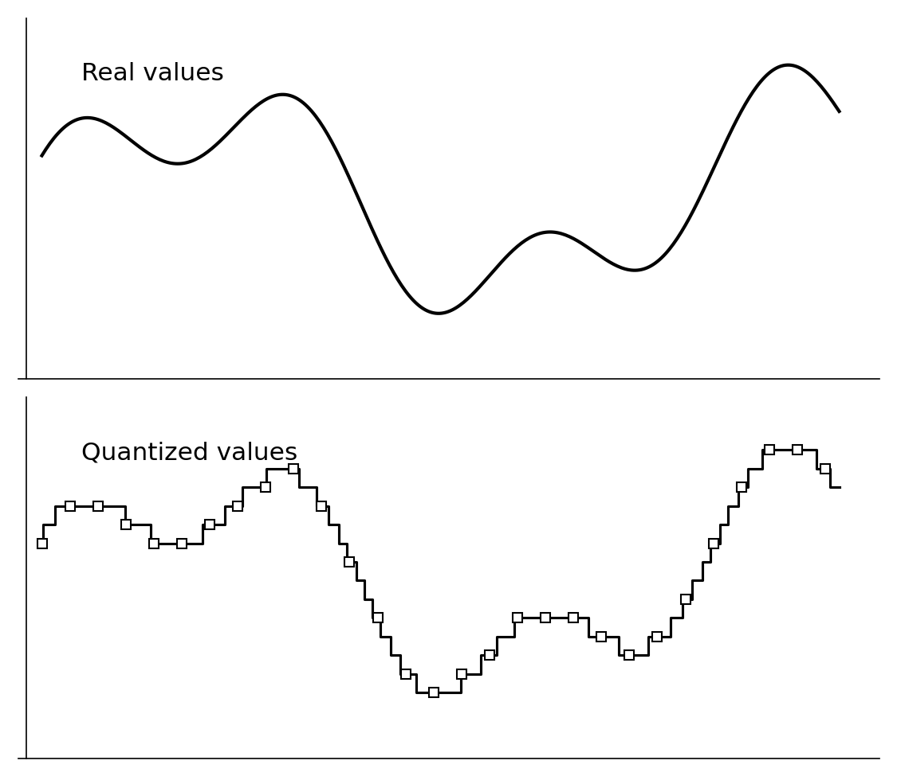
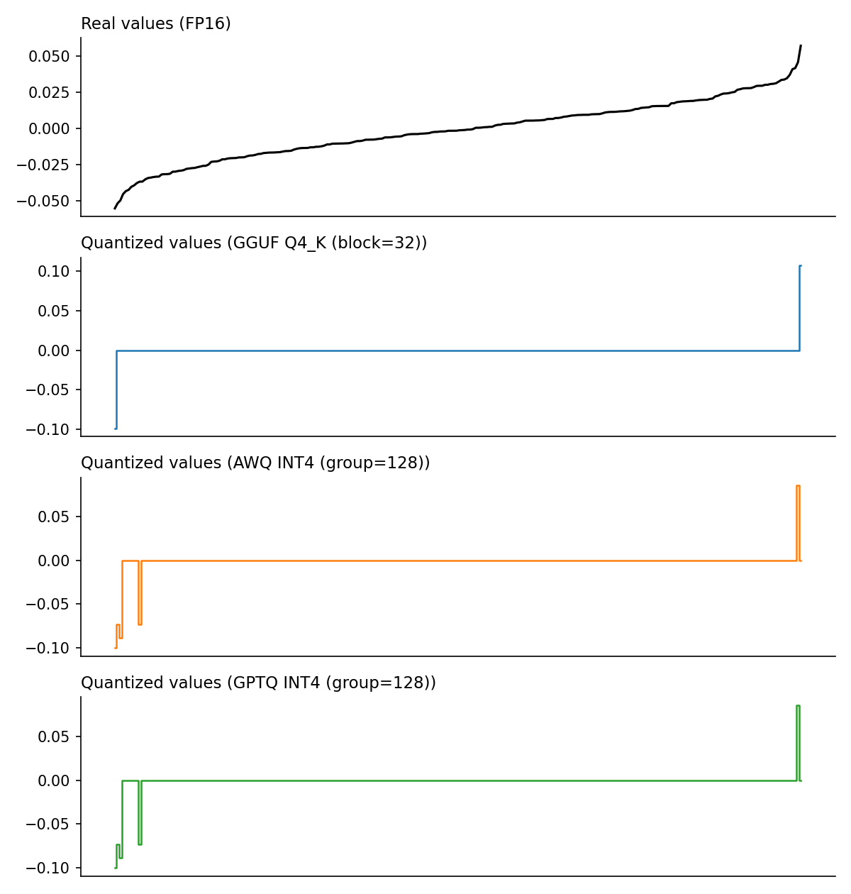

# ParaPulse QuantAssessment

**How much did quantization cost this model? Measure it against the original weights, and record output-quality evals in a form you can actually compare.**

QuantAssessment evaluates quantized LLMs (GGUF, AWQ, GPTQ) against the model
they were derived from. It produces two kinds of versioned, JSON-Schema-backed
reports:

- **`QuantAssessment`**: weight reconstruction error. Dequantize sampled
  tensors, compare them element-wise with the original FP16/BF16 weights, and
  report relative error, SQNR, cosine similarity and max absolute error, per
  tensor and aggregated by layer and role. It never runs the model and only
  downloads the tensor bytes it samples.
- **`EvalRecord`**: output quality. Imports PPL / KL-divergence results that
  you ran elsewhere (`llama-perplexity`, transformers) together with the
  metadata needed to decide whether two results can be compared at all.

It is the companion project to
[ParaPulse ModelSpec](https://github.com/parapulseio/ModelSpec), which
describes *what a model is*. QuantAssessment describes *how good a quantized
variant is relative to a reference*. See
[Relationship to ModelSpec](#relationship-to-modelspec) for where the line is.

> **Status: design / pre-alpha.** Nothing is installable yet. This README
> records the scope, report model and methodology agreed so far. CLI and
> package names below are working names.



## Why

"Q4_K_M", "AWQ 4-bit" and "GPTQ 4-bit" sound comparable, but they are not:

- They differ in scale granularity (per-group of 128 vs 32-element blocks with
  256-element super-blocks), in mixed-precision layout (`Q4_K_M` keeps some
  `attn_v` / `ffn_down` tensors at `Q6_K`), and in whether calibration data
  (imatrix, AWQ activation scaling, GPTQ second-order updates) was used.
- Two files with the same label from different quantizers can differ in
  quality, and the label usually does not tell you whether an imatrix was used.
- Published PPL numbers are often not comparable: different tools, datasets,
  context lengths, chunk counts and scoring schemes give different absolute
  values.

QuantAssessment provides a reproducible, inspectable way to answer "how far is
this file from its original?", and stores results so that only like-for-like
comparisons are made.

## What it measures

Quantization quality can be assessed at three levels, each more expensive than
the last:

| Level | What | Needs | Where it lives |
|---|---|---|---|
| **A. Static metadata** | imatrix KV, per-tensor quant types, measured bpw, which layers are quantized | headers only | **ModelSpec** (done) |
| **B. Weight reconstruction error** | dequantize, compare with original weights, optionally imatrix-weighted | partial weight bytes + numpy | **this repo**, `QuantAssessment` |
| **C. Output quality** | PPL and KL divergence | full weights, GPU, inference | **this repo**, `EvalRecord` (ingest only, never computed) |

Weight error is a diagnostic, not a verdict. AWQ, GPTQ and imatrix optimize
*output* error, so a variant with a slightly lower weight SQNR can produce better
outputs. Rank variants by KLD (level C). Use weight error (level B) to explain
and locate problems: which layers, which tensor roles, which outliers.

## Reports

Both reports are standalone Pydantic v2 models, each with its own JSON Schema and
`schema_version`. They do not nest inside each other or inside `ModelSpec`. They
link to models by **`repo_id` + commit SHA**; without the SHA a report cannot
be tied to a specific file version.

### `QuantAssessment` (level B)

| Section | Contents |
|---|---|
| Subject | quantized repo id, commit SHA, file (e.g. a specific `.gguf`), format (`gguf` / `awq` / `gptq`) |
| Reference | original repo id and commit SHA, and how it was chosen: resolved from ModelSpec `identity.lineage` or given with `--base` |
| Method | sampled tensors, sampling rule, random seed, tool version, dequantization implementation |
| Per-tensor results | HF name and GGUF name, quant type, shape, comparison mode (element-wise, or distribution-only for permuted tensors), relative error, SQNR, cosine similarity, max absolute error |
| Aggregates | by tensor role and by layer |
| Optional | imatrix-weighted error and the provenance of the imatrix used |
| Warnings and cost | skipped tensors with reasons (e.g. unsupported packing), bytes actually downloaded |

### `EvalRecord` (level C)

| Section | Contents |
|---|---|
| Subject / reference | same as above |
| Comparability metadata (**required**) | tool and version (e.g. llama.cpp build number), dataset and hash, context length `-c`, `--chunks`, scoring scheme (second half of each chunk vs all positions) |
| Metrics | PPL of quant and base, mean ln(PPL ratio), KLD mean / median / 99% / 99.9% / max, mean Δp, RMS Δp, same-top-p |
| Raw output | the original text as imported, kept for later auditing |

Records without complete comparability metadata are rejected. Comparison
helpers only compare records whose comparability metadata match.

## Planned usage

```bash
# Level B: weight reconstruction error. Reference resolved from ModelSpec lineage.
quantassess assess bartowski/Llama-3.2-1B-Instruct-GGUF --file Llama-3.2-1B-Instruct-Q4_K_M.gguf
quantassess assess some-org/Llama-3.2-1B-Instruct-AWQ --base meta-llama/Llama-3.2-1B-Instruct -o report.json

# Opt into more coverage; prints a download-size estimate before fetching
quantassess assess <repo> --all-layers
quantassess assess <repo> --imatrix imatrix.gguf

# Optional step plot (needs the plotting extra)
quantassess assess <repo> --plot layer10_down_proj.png

# Level C: import externally produced results
quantassess ingest llama-perplexity-kld.log --subject <repo>@<sha> --base <repo>@<sha> \
    --dataset wiki.test.raw -c 512 --chunks 100
quantassess ingest hf-eval.json          # documented JSON format for transformers-side evals

# Schemas
quantassess schema assessment
quantassess schema eval-record
```

Default sampling is `mlp.down_proj` and `self_attn.v_proj` at the first, middle
and last layers. That covers the tensors where formats diverge most while
keeping a ≤ 1B model under ~200 MB of transfer.

## Methodology

### Fetching only what is needed

- **safetensors** (original, AWQ, GPTQ): three HTTP Range requests per tensor:
  8-byte header length → JSON header → the `data_offsets` slice. Shards are
  located via `model.safetensors.index.json`. BF16 is converted manually since
  numpy has no bfloat16.
- **GGUF**: parse the header ourselves, keep each tensor's data offset, align
  with `general.alignment`, size it from the ggml type tables, and Range-fetch
  the slice. Dequantization uses `gguf-py`'s implementations; there is no
  hand-written K-quant / IQ decoder.

### Dequantization rules

| Format | Layout on disk | Dequant | Pitfalls |
|---|---|---|---|
| AWQ (GEMM) | `qweight [in, out/8]`, `qzeros [in/g, out/8]`, `scales [in/g, out]` | `w = (q − z) · s`, then transpose to `[out, in]` | int4 nibbles are interleaved; unpack with reverse order `[0,4,1,5,2,6,3,7]` |
| GPTQ (v1) | `qweight [in/8, out]` packed along rows, `qzeros` packed along columns | `w = (q − (z + 1)) · s`, then transpose | stored zeros are off by one; `desc_act=True` needs `scale[g_idx[row]]` |
| GPTQ (`gptq_v2`) | as above | `w = (q − z) · s` | **no** `+1`; detect from `checkpoint_format` |
| GGUF | per-type blocks | `gguf-py` dequantize | names differ from HF; Llama `attn_q` / `attn_k` rows are permuted for RoPE |

Unsupported packings (AutoAWQ GEMV, Marlin, ExLlama-repacked, …) are refused
with an explicit error rather than producing wrong numbers. Every dequant path
needs a round-trip test (synthetic matrix → pack → load → compare), and shapes
are asserted before any metric is computed. A silent transpose mismatch produces
plausible-looking but meaningless results.

### Comparing tensors

- HF ↔ GGUF names are mapped per architecture via `gguf-py`'s `TensorNameMap`.
  Tensors that cannot be mapped are marked "not comparable" instead of guessed.
- Permuted tensors (GGUF `attn_q` / `attn_k` in Llama-family models) are
  inverse-permuted when head counts are known, otherwise compared at the
  distribution level (independently sorted, Q-Q style). The report records
  which mode was used.
- Unquantized tensors (norms, embeddings, usually `lm_head` in AWQ/GPTQ) are
  skipped and listed with the reason.

### Metrics

| Metric | Formula | Reading |
|---|---|---|
| Relative error | `‖W − Ŵ‖ / ‖W‖` | lower is better, comparable across layers |
| SQNR (dB) | `10 · log10(ΣW² / Σ(W − Ŵ)²)` | higher is better; ~+6 dB per extra bit in theory |
| Cosine similarity | `⟨W, Ŵ⟩ / (‖W‖ · ‖Ŵ‖)` | closer to 1 is better, insensitive to global scale |
| Max absolute error | `max \|W − Ŵ\|` | how badly outliers were handled |
| imatrix-weighted (optional) | weight each input column by `E[x_j²] = in_sum2 / counts` | approximates layer output error without inference |

The imatrix used for weighting should come from the original model. The report
warns when it is the same imatrix that produced the quant being assessed, because
that biases the result in the quant's favor.



*Synthetic weights (normal + 0.1% outliers, mimicking `down_proj`), sampled and
sorted by original value. A single outlier inflates its block's or group's
scale, and most of the small values in that block or group collapse onto the
zero level. Finer granularity limits how far the damage spreads.*

### Output quality (ingest only)

QuantAssessment does not run models. Use `llama-perplexity` (GGUF) or a
transformers script (AWQ/GPTQ) and import the results. Rules of thumb:

- **Rank by mean KLD, assess risk with 99% / 99.9% KLD, communicate with
  same-top-p and ΔPPL.**
- llama.cpp scores only the second half of each chunk by default, while a naive
  transformers loop scores every position. Results from the two are not
  comparable, and `EvalRecord` keeps them apart.
- Generate the KLD base logits and run the comparison with identical `-c` and
  `--chunks`.
- Never calibrate (imatrix) on the evaluation set.

## Storage

QuantAssessment does not maintain a results database:

1. **Default**: write JSON to stdout, or to a file with `-o`.
2. **ModelSpec download directory**: when the input is a directory produced
   by `modelspec extract --download-only`, write to
   `./<repo_id>/assessments/<reference>__<method-hash>.json`, next to
   `MODELSPEC_MANIFEST.md`, so the report shares the manifest's commit SHA.
3. **Long-term persistence**: ParaPulse ingests reports keyed by
   *(subject SHA, reference SHA, method)*, using the published JSON Schemas.

Cross-model leaderboards (e.g. every Q4_K_M of one base model ranked by SQNR /
KLD) come after the single-report format has stabilized.

## Relationship to ModelSpec

| | ModelSpec | QuantAssessment |
|---|---|---|
| Describes | intrinsic properties of **one** model | a **subject × reference × method** combination |
| Cardinality | one spec per model | many reports per model (different references, datasets, sampling) |
| Inputs | metadata only, never weights | B: sampled weight bytes; C: external eval output |
| Size | bounded | per-tensor results can run to hundreds of rows |

Static quantization metadata (level A: `has_imatrix`, mixed-precision layout,
measured bpw, quantized-module lists) stays in ModelSpec because it is a
property of the file. QuantAssessment depends on ModelSpec for repo and
revision resolution, lineage-based reference discovery, header fetching, and
architecture info such as head counts.

## Roadmap

Task breakdown, dependencies and ordering: [Phase B / C development plan](docs/plans/2026-10-07-phase-b-c-development-plan.md).

- [ ] Package skeleton, report models (`QuantAssessment`, `EvalRecord`), JSON Schema export
- [ ] Range-request tensor fetch for safetensors and GGUF
- [ ] AWQ (GEMM), GPTQ (v1, v2, `g_idx`) and GGUF dequant with round-trip tests
- [ ] HF ↔ GGUF name mapping and `attn_q` / `attn_k` handling, Llama family first
- [ ] `assess` CLI with default sampling, byte estimate, optional plot
- [ ] **Prototype gate**: end-to-end on a ≤ 1B model with GGUF Q4_K_M + AWQ + GPTQ, < 200 MB transferred; keep, extend or drop depending on whether the numbers are useful to ParaPulse
- [ ] imatrix-weighted error
- [ ] `ingest` for `llama-perplexity` output and a documented HF-eval JSON format
- [ ] Cross-report comparison and leaderboards

## Background reading

- ModelSpec plan: [Quantization Quality Assessment](https://github.com/parapulseio/ModelSpec/blob/main/docs/plans/2026-10-07-quantization-quality-assessment.md)
- [safetensors metadata parsing](https://huggingface.co/docs/safetensors/metadata_parsing) (Range-request tensor access)
- [llama.cpp perplexity tool](https://github.com/ggml-org/llama.cpp/tree/master/tools/perplexity) (PPL / KLD output and scoreboard)
- [llama.cpp imatrix tool](https://github.com/ggml-org/llama.cpp/tree/master/tools/imatrix)
